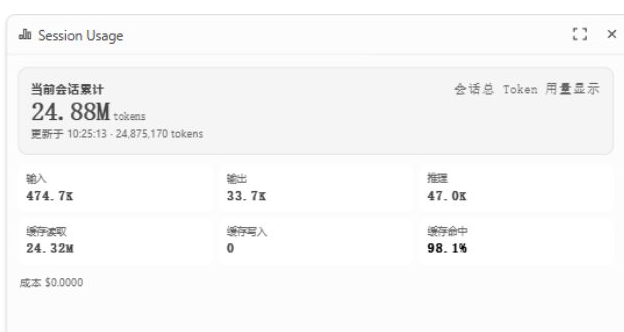

# OpenChamber Session Usage

An unofficial [OpenChamber](https://github.com/openchamber/openchamber) extension that shows the **current session's cumulative token usage**, not just the latest assistant message's context fill.

OpenChamber's built-in context meter reads the newest assistant message to show how full the context window is. This extension reads the session record that OpenCode maintains, so it can show the whole session's accumulated input, output, reasoning, cache reads and cache writes.



## Features

- **Sidebar panel** with the full breakdown
- **Work Status section** for an always-visible compact readout
- Cumulative totals: input, output, reasoning, cache read, cache write
- Total tokens, cost, cache hit rate
- Optional roll-up of child sessions
- Refreshes every 2 seconds; switches sessions and finished turns refresh immediately

## Install

### From GitHub

In OpenChamber, open **Settings → Extensions** and paste:

```
https://github.com/chaos-318/openchamber-session-usage
```

Approve the requested permission. The extension asks for one capability: **run a local service**. The approval dialog warns that a local service runs with your user permissions; this service only reads the OpenCode SQLite database and never writes to it or accesses the network.

### From a folder

```bash
git clone https://github.com/chaos-318/openchamber-session-usage.git
```

Then add that folder path in **Settings → Extensions**.

OpenChamber runs folder installs in place. After editing the panel or service, reload the panel or restart OpenChamber.

## Where it appears

- A **Session Usage** icon in the right rail opens the full panel.
- A **Session Token** section in the Work Status panel shows the compact version.

## How it works

The extension ships a small local service (`service/main.js`) that opens the OpenCode database read-only:

```
~/.local/share/opencode/opencode.db
```

It reads `session_v2` (OpenCode 2.x), falling back to `session` for older databases:

```
tokens_input, tokens_output, tokens_reasoning,
tokens_cache_read, tokens_cache_write, cost, parent_id, time_updated
```

These are OpenCode's own per-session cumulative counters. The service listens on `127.0.0.1` only and checks the bearer token that OpenChamber passes at startup. The panel talks to it through `host.serviceRequest`.

The extension does not parse messages, estimate tokens from text, or write to the database.

### Why the number is much bigger than the context window

Every tool call in a multi-step turn re-reads the cached prompt. The session total therefore includes all of those cache reads, so a long session can show tens of millions of tokens while the context window holds only a few hundred thousand. That is the point: it is a consumption total, not a context-fill percentage.

## Build

The panel is TypeScript and must be bundled into a single classic IIFE because OpenChamber's sandboxed iframe does not load ES modules. `panel/main.js` is committed so installing from GitHub does not require a build.

To rebuild:

```bash
./build.sh
```

`build.sh` looks for `@openchamber/sdk` inside a global OpenChamber install. If it cannot find it, set the path explicitly:

```bash
OPENCHAMBER_SDK_PATH=/path/to/@openchamber/sdk ./build.sh
```

The service is plain JavaScript and needs no build.

## Requirements

- OpenChamber web or desktop 2.5.0 or newer
- OpenCode 2.x (the `session_v2` schema). Older databases with a `session` table are supported when the token columns exist.
- The Node.js that OpenChamber uses must expose `node:sqlite` (Node 22.5+; OpenChamber's bundled runtime qualifies).

Extensions do not load in the VS Code extension or the mobile apps. A browser or desktop client connected to the same OpenChamber instance sees the extension and the data from that server.

## Limitations

- The SQLite schema is internal to OpenCode. If a future OpenCode version renames the table or columns, the panel shows a readable error instead of breaking OpenCode.
- `node:sqlite` is marked experimental in Node 22; it is available in the runtime OpenChamber uses.
- The panel and the Work Status section share one HTML entry and switch layouts based on `ctx.surface`.

## Uninstall

**Settings → Extensions → Session Usage → Remove.** For a folder install this only forgets the path; your folder is left untouched. The local service stops with the extension.

## 中文说明

一个非官方的 OpenChamber 扩展：显示**当前会话从开始到现在的累计 token 用量**，而不是最近一条助手消息的上下文占用。

OpenChamber 自带的上下文圆环读取的是最新一条 assistant 消息，用来表示当前上下文窗口有多满。这个扩展读取 OpenCode 自己维护的会话记录，因此能显示整个会话累计的输入、输出、推理、缓存读取和缓存写入。

### 功能

- 右侧栏面板：输入、输出、推理、缓存读取、缓存写入、总计、成本、缓存命中率
- Work Status 分区：聊天旁的常驻紧凑显示
- 有子会话时显示「含子会话」汇总
- 每 2 秒刷新；切换会话、本轮回答完成时立即刷新

### 安装

在 OpenChamber 的 **设置 → 扩展** 中粘贴：

```
https://github.com/chaos-318/openchamber-session-usage
```

批准「运行本地服务」权限。这个扩展只请求这一项权限；服务只读 OpenCode 数据库，不写文件、不联网。

### 数据来源

扩展的本地服务以只读方式打开：

```
~/.local/share/opencode/opencode.db
```

优先读取 `session_v2` 表的 `tokens_input`、`tokens_output`、`tokens_reasoning`、`tokens_cache_read`、`tokens_cache_write`、`cost`、`parent_id` 等列；旧库会回退到 `session` 表。这些是 OpenCode 自己维护的会话累计值，不是从消息文本估算的。

### 为什么数字远大于上下文窗口

多步工具调用会反复读取缓存提示词，会话累计值包含这些缓存读取，所以长会话可能显示几千万 token，而上下文窗口只有几十万。这是「消耗总量」，不是「上下文占用百分比」。

### 限制

- 依赖 OpenCode 的内部表结构；升级后如果表名或列名变化，面板会显示错误，不影响 OpenCode 本身。
- 手机 App 和 VS Code 不加载 OpenChamber 扩展；浏览器或桌面客户端连接同一个 OpenChamber 实例时可用。
- 面板和 Work Status 分区共用同一个页面，按 `ctx.surface` 切换布局。

## License

MIT. See [LICENSE](LICENSE).

This is a community extension, not an official OpenChamber project.
